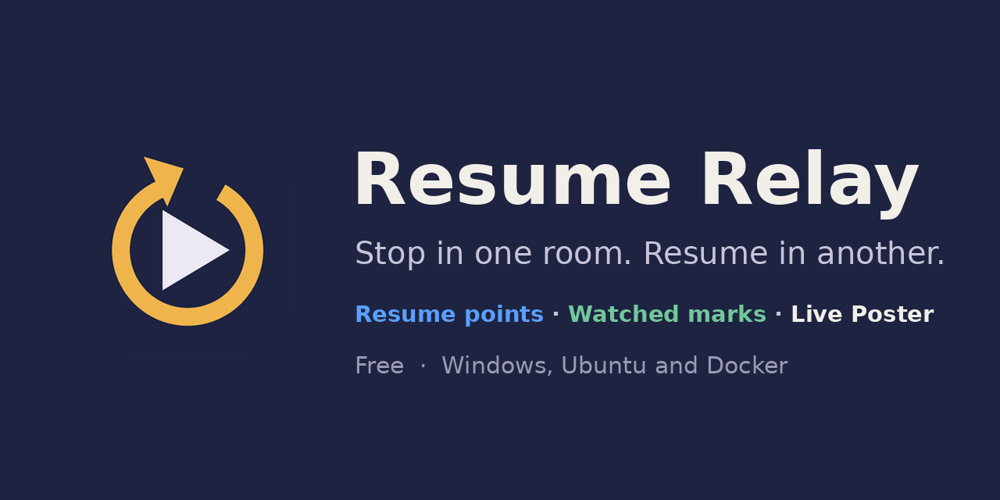

# Resume Relay

**Stop a movie or episode on one Zidoo, walk to another room, and press Resume.**



Resume Relay watches every Zidoo player on your network. A few seconds after one stops, it copies
that file's resume point to all the others. You don't need a watch list or any setup per title:
anything you watch is copied.

### ⬇ [Download the latest version](https://github.com/ckenisell/resume-relay/releases/latest)

On that page, scroll down to **Assets** and pick your file:

| | File | |
|---|---|---|
| **Windows 10 / 11** | `ResumeRelay-<version>-windows.exe` | A single file with nothing else to install. Put it somewhere permanent (for example your Documents) and run it. |
| **Ubuntu 22.04 / 24.04 / 26.04** | `resume-relay-<version>-linux.tar.gz` | A background service, ideal for an always-on PC or server. Unpack it and run `./install.sh`. |
| **Docker / NAS** (Synology, uGreen and others) | `ghcr.io/ckenisell/resume-relay` | No download needed: your NAS fetches it. See [Docker and NAS](#docker-and-nas-synology-ugreen-and-others) below. |

Ignore the two "Source code" files; they're the raw code, not the app. Run only **one** copy of
Resume Relay per home, on a computer that stays on while you watch.

Resume Relay is free to download. If it saves you some walking, you can
**[☕ buy me a coffee](https://buymeacoffee.com/chetkenisell)**.

## What it does

- **Works with Plex and Jellyfin too.** Sign in in Settings and add your Plex or Jellyfin users: resume points and
  watched marks then sync between the Zidoos, Plex and Jellyfin, in every direction.
- **Copies resume points between rooms automatically.** Within seconds of stopping, the same file
  on every other player resumes where you left off, to the exact second. Movies, TV episodes and
  extras are all matched exactly by file path.
- **The latest stop always wins.** It replaces the other players' bookmark for that file, even if
  theirs is further along. Short stops count too.
- **Finishing marks it watched everywhere.** Auto-play to the next episode counts as finishing the
  previous one.
- **Stopping at 0:00 resets the title everywhere.** Start something from the beginning and stop it
  straight away, and the other players clear their bookmark and watched mark too.
- **Reset Progress from the Activity tab.** One button clears a file's bookmark and watched mark on
  every player.
- **Progress Reset tab.** Read your players to see every file you've started, how far in it is on each
  player and when it was last watched, sorted by title or date. Reset one file, or every episode of a
  TV show, on all players at once.
- **Watch Sync tab.** See where each movie and episode is marked watched on every player, find the ones
  that differ, and mark them watched or unwatched per player or on all players at once.
- **Sleeping players catch up.** A player that's off, asleep, or on without its Home Theater app
  open gets its copies as soon as it's ready. Waiting copies are shown on that player's card and
  kept for 120 days (you can change this in Settings).
- **Turn players on and off.** Each player has a power button like Z-Keeper's: red is off, green is
  on, and an orange ring spins while it's switching. **Launch HT** opens the Home Theater app.
- **Copy all, then undo if needed.** On Progress Reset and Watch Sync, copy one player's progress or watched marks to
  the others for every file in the list, and undo any batch from its Activity card.
- **Tells you when there's a new version,** with the exact steps to update.
- **Catches up after downtime.** If Resume Relay was off, it reads the players when it starts and copies whatever
  was watched meanwhile (newest wins), with Undo.
- **Easy to set up and move.** A getting-started checklist for new installs, health notes when something needs
  attention, and a one-file backup of your players and settings.
- **See every copy.** The Activity tab shows a card for each stop, with the poster, whether it happened on a Zidoo
  or on Plex, and a mark for every other player: ✓ copied, ◷ waiting, – skipped, ✕ failed.
- **Every write is checked.** Before writing, it confirms the player's entry really is that file.
  After writing, it reads the position back, because some Home Theater builds report errors for
  writes that actually worked.
- **Finds your players for you.** Scan the network, then give each player a room name. Players are
  recognised by their hardware address, so a name stays put even if your router gives the player a
  new IP.
- **Use it from your phone.** Open `http://<computer-address>:8090` on any device on your network.

## Requirements

- One of:
  - **Windows 10 or 11**
  - **Ubuntu 22.04, 24.04 or 26.04**
  - **Docker**, for example on a **Synology** NAS (DSM 7.2 or later, with Container Manager), a
    **uGreen** NAS (UGOS Pro, with the Docker app), QNAP, Unraid or TrueNAS. Intel/AMD and ARM
    (64-bit) are both supported. The container must use **host networking**.
- Zidoo players with **Home Theater v5.1.11 (code 5111) or newer**
- Optional: a **Plex Media Server** or **Jellyfin** (10.9 or newer) server that reads the same network share as the Zidoos
- Your video files on a network share (SMB or NFS) that all players use, so each file has the same
  path everywhere
- To turn players on from the app (Wake-on-LAN): the player in standby (not unplugged), on a
  **wired** connection, with network wake-up allowed in its settings

## First run

1. Press **Scan network**. Every Zidoo that's switched on is listed.
2. Click each player's name and give it a room name.
3. It starts in **Watch-only** mode, which shows what it would copy without writing anything.
   Play something on one player, stop it, and check **Activity**. When it looks right, press
   **Start copying**.

## Plex

The **Plex** card in **Settings** (the gear tab) sets it up:

1. **Sign in with Plex.** Enter the code it shows at [plex.tv/link](https://plex.tv/link) on any device signed in to
   Plex. Your Plex server is found by itself.
2. **Folders (optional).** Usually not needed. Plex and the Zidoos reach the same files by different paths (for
   example `/shares/Entertainment/Movies/…` on the Plex server and `smb://10.0.0.56/Entertainment/Movies/…` on the
   Zidoos), so Resume Relay matches them by the end of the path (`Arrival (2016)/Arrival (2016).mkv`). That works with no
   Zidoos at all, too: Plex alone, or Plex and Jellyfin. **Compare two players** on the Watch Sync tab shows how two
   players' files line up; if it lists files with the same name in a different folder, add a folder here (which Plex
   folder is which Zidoo folder). Once a Zidoo has played something Plex also has, the card fills one in for you.
3. **Add users.** The server's owner and any Plex Home users (with their PIN if they have one). Each becomes a player
   card on the Players tab.

Plex counts a file as finished at about 90% (its default), so finishing in Plex marks it watched on the Zidoos. If
Plex doesn't keep a very early resume point (a stop in the first minute), the Activity chip says so.

## Jellyfin

The **Jellyfin** card in **Settings** sets it up (it starts folded away: open it with the triangle):

1. **Your server.** Resume Relay finds Jellyfin on the network by itself, or type its address (like `10.0.0.30:8096`).
2. **Sign in as a Jellyfin administrator**, one of three ways: a **user name and password** (Resume Relay keeps only
   the sign-in Jellyfin gives back, never the password), **Quick Connect** (approve the code it shows in a Jellyfin app,
   under your profile → Quick Connect), or an **API key** (Jellyfin: Dashboard → API Keys). It has to be an
   administrator: only they can see what everyone is playing and copy everyone's progress. The users you add sign in
   to nothing.
3. **Folders (optional)**, as on the Plex card: usually not needed. When Plex runs on the same computer, its folders are suggested.
4. **Add users.** Each becomes a player card on the Players tab, in purple.

Finishing a file in Jellyfin (it counts 90% as finished by default) marks it watched on the other players. Highly
Acclaimed never uses Jellyfin's ratings: it takes IMDb's rating (or TMDB's when there's no IMDb rating) from Plex or a
Zidoo.

## Live Poster

A TV, stick or tablet hung outside a room shows the poster of what that room is playing, over a background of your
own design ("NOW SHOWING"…), and a slideshow when nothing is: **Coming Soon** (posters you add), **Recently Watched**
**Highly Acclaimed** (movies and series rated 8.0 or higher: Plex's ratings, or without Plex the Zidoo's, IMDb for
movies and TMDB for series; 10 picked at random each round) and **Feature Presentation** (one movie, or one season of a
TV show, that each screen chooses for itself, once per round). Set it all up on the **Live Poster** tab. A **Kaleidescape** can be followed too (Live Poster only: it plays its own
copies of movies, so nothing is copied to or from it); its movie shows with the Kaleidescape's own cover. So can an
**Apple TV** (Live Poster only too):

- **Scan network** finds it. On its card on the Players tab, press **Pair**, and type the PIN the TV shows (once).
  If no PIN appears, on the Apple TV open Settings → AirPlay and HomeKit, and set **Allow Access** to include this
  network.
- **The Plex app:** Resume Relay asks your Plex server what that Apple TV is playing, and uses Plex's poster (or your
  folder's). Plex only needs to be signed in on the Plex card; the Plex user doesn't need to be added.
- **Any other app** (Peacock, Prime Video, Netflix, Disney+…): the title the app tells the Apple TV. If it's in your
  library, its poster comes from there (your NAS folder, then Plex); otherwise from TMDB (the poster TMDB shows on the
  title's page when it's 2000×3000, the season's poster for an episode), found by the title's name, year and length.
  Apps differ in how much they say; one that says nothing shows nothing. **What it sends** on the Apple TV's card shows
  exactly what each app says. Every title shows on the Activity tab, with the app it played in.
- It uses the Apple TV's own remote protocol (as the iPhone's Remote does), through
  [AppleTvControlLibrary](https://github.com/oznetmaster/AppleTvControlLibrary) (MIT), a port of
  [pyatv](https://github.com/postlund/pyatv). Apple doesn't publish it, so a tvOS update could change it.

- **4K:** stick and TV apps draw their own pictures at 1080p but play video at 4K, so Resume Relay turns each picture
  into a short 4K video (with ffmpeg, on the computer's video hardware when it can) and the screen app plays it.
- **Posters:** movies come from the movie's folder (`<video file name>-poster.jpg`, `poster.jpg`…), then Plex, then the
  Zidoo (which keeps them at 500×750). TV shows: the season poster in the show's folder (`season01-poster.jpg`,
  `Show S01-poster.jpg`, or `poster.jpg` inside a `Season 01` folder), then the series poster, then Plex's, then the
  Zidoo's.
- **Backgrounds:** marquee designs are built in; or your own 2160×3840 PNG/JPG/WebP or a 10–20 second MP4 loop. A PNG or WebP
  with a see-through window goes in front of the poster (its frame and shadows fall on the poster). The poster is 2000×3000, centered across and set low, which
  leaves 80 px at the sides, 750 px at the top and 90 px at the bottom.
- **Screens:** the easiest today is **any web browser**: open `http://<this computer>:8090/screen` on the TV, tablet or
  PC, and add the 4-digit code it shows on the Live Poster tab. Click the page once to go full screen. The screen apps
  (Android for Fire TV, Google TV, phones and tablets, and Roku) are on their way to the app stores; until then:
  - **Roku:** turn on Developer Mode (on the remote: Home 3×, Up 2×, Right, Left, Right, Left, Right; set a password),
    open the Roku's address in a browser on your computer, and upload `ResumeRelay-Screen-…-roku.zip`.
  - **Android phone or tablet:** open the `…-android.apk` download on it and allow installing it.
  - **Fire TV / Google TV:** install it with the *Downloader* app (enter the APK's download link).
- **Mounting a TV upright:** TVs and sticks always send a landscape picture, so tell Resume Relay which way the TV is
  turned and check the **Test picture** (the arrow should point up).
- Avoid TVs that can get burn-in (OLED, plasma): a poster can stay up for hours.
- **Docker:** pass the video hardware through (`devices: - /dev/dri:/dev/dri`) for hardware encoding; screen apps find
  Resume Relay with a broadcast on UDP port 47090 (host networking passes it through).

## Windows app

- Opens in its own window. Closing the window keeps it running in the tray, so bookmarks keep
  syncing. Right-click the tray icon to quit.
- **Starts with Windows** by default, straight to the tray. Untick it in Settings or the tray menu.
- The first time you run it, Windows may show *"Windows protected your PC"* because the app isn't
  code-signed. Click **More info → Run anyway**. If Windows asks about network access, allow
  **Private networks**.
- Needs Microsoft Edge WebView2, which is built into Windows 10 and 11.

## Linux service

Unpack the download and run `./install.sh`. It installs the .NET runtime from Ubuntu's own archive
if needed and sets Resume Relay up to start with the computer. Upgrading keeps your players and
settings. Full instructions are in the `README.md` inside the download.

## Docker and NAS (Synology, uGreen and others)

The Docker image is the same program as the Windows and Ubuntu downloads, so it works exactly the
same way. It runs on Intel/AMD and ARM (64-bit) NAS models. Run only one copy of Resume Relay per
home: if you move it to your NAS, quit or uninstall it on your PC.

Everything is set up from this short "docker-compose" text. You'll paste it in during setup:

```yaml
services:
  resume-relay:
    image: ghcr.io/ckenisell/resume-relay:latest
    container_name: resume-relay
    # Required: lets "Scan network" find your players and the power button wake them.
    network_mode: host
    restart: unless-stopped
    environment:
      # The page opens at http://<nas-address>:8090. Change it if 8090 is already used on the NAS.
      - RESUMERELAY_PORT=8090
    volumes:
      # Players, names, settings and Activity are kept here, in a "data" folder next to this file.
      # Synology and some other NAS: create the "data" folder first, or the project won't start.
      - ./data:/data
      # Optional (Live Poster): your movie and TV folders, read-only, so posters can come from them.
      # Remove the # and put your media shared folder's path on the left (see "Optional extras" below).
      # - /volume1/Media:/media:ro
    # Optional (Live Poster), Intel NAS with built-in graphics only: makes poster videos on the video hardware.
    # Remove the # from both lines to use it. Leave them as they are on AMD and ARM models.
    # devices:
    #   - /dev/dri:/dev/dri
```

**Keep `network_mode: host`.** Without it the container sits on Docker's own private network inside
the NAS: talking to players by IP address still works, but **Scan network** finds nothing and the
**power button** can't turn players on.

### Synology (DSM 7.2 or later)

1. Open **Package Center**, search for **Container Manager** and install it. If it isn't listed,
   your model doesn't support Docker.
2. Open **File Station**. In the **docker** shared folder (Container Manager creates it), create a
   folder named **resume-relay**, and inside it a folder named **data**. Container Manager won't
   create the **data** folder for you: without it, the project stops with "Bind mount failed".
3. Open **Container Manager → Project → Create**.
   - **Project name:** `resume-relay`
   - **Path:** choose the **docker/resume-relay** folder you just made
   - **Source:** **Create docker-compose.yml**, then paste the text above
4. Click **Next**, skip the Web Station page, and click **Done**. Container Manager downloads the
   image and starts it.
5. Open `http://<your-nas-address>:8090` in a browser and follow [First run](#first-run).

**If the DSM firewall is on**, open two ports for Resume Relay: **TCP 8090** (or the page won't open
from other devices) and **UDP 47090** (or Live Poster screen apps can't find Resume Relay by
themselves). If it's off, skip this. To check, and to add the rules:

1. Open **Control Panel → Security → Firewall**. If **Enable firewall** isn't ticked, you're done.
2. Next to the firewall profile in use, click **Edit Rules**, then **Create**.
3. **Ports:** choose **Custom**, then click **Custom** (or **Select**) beside it:
   - **Type:** Destination port
   - **Protocol:** TCP
   - **Ports:** `8090` (or the port you chose with `RESUMERELAY_PORT`)

   Click **OK**.
4. **Source IP:** choose **Specific IP**, click **Select**, choose **Subnet**, and enter your home
   network, for example IP address `192.168.1.0` with subnet mask `255.255.255.0`. Use the first three
   numbers of your NAS's own address followed by `.0`: a NAS at `10.0.0.56` means `10.0.0.0`.
   (**All** works too, but lets in anyone who can reach the NAS, including from the internet if a
   port is forwarded.)
5. **Action:** Allow. Click **OK**.
6. Click **Create** again and make the same rule with **Protocol: UDP** and **Ports:** `47090`.
7. The rules are checked from the top down, so make sure both new rules sit **above** any rule that
   denies access (drag them up if needed). Click **OK**, then **Apply**.

Menu names can differ slightly between DSM versions.

**Moving from another computer?** On the old one, open **Settings → App → Back up settings** first.
Once the NAS copy is running, use **Restore from a backup** there, then quit or uninstall the old
copy: run only one Resume Relay per home.

**Updating:** Container Manager doesn't notice new versions of images from GitHub's registry (its
**Update available** label only appears for some registries), so update by hand. Your players and
settings are kept in the **data** folder throughout:

1. **Container Manager → Project**, select **resume-relay**, then **Action → Stop**.
2. **Action → Clean**. This removes the container, not your **data** folder.
3. **Container Manager → Image**, select `ghcr.io/ckenisell/resume-relay`, and click **Delete**.
4. Back in **Project**, select **resume-relay** and click **Build**. Container Manager downloads the
   newest version and starts it. The page's footer shows the version number.

### Optional extras for Live Poster (any NAS)

The setup above runs everything. Two extras make Live Poster better on a NAS; both are the lines
marked *Optional* in the docker-compose text. To add them later, edit the project's
docker-compose.yml (Synology: **Container Manager → Project → resume-relay → YAML configurations**),
then rebuild or redeploy the project.

- **Posters from your movie folders.** Resume Relay looks for a poster next to each movie first
  (`poster.jpg`, `<movie name>-poster.jpg`…). Inside the container it can only see the folders you
  give it:
  1. Find your media shared folder's path on the NAS. Synology: in **File Station**, right-click the
     folder → **Properties**, and copy **Location** (for example `/volume1/Media`).
  2. In the docker-compose text, remove the `#` in front of `- /volume1/Media:/media:ro` and put your
     path on the left of the `:`. `:ro` means read-only: Resume Relay never changes your files.
  3. In Resume Relay's **Live Poster** tab, open **Poster folders → + Add folder**: on the left, the
     folder as your Zidoos see it (for example `smb://192.168.1.20/Media`), on the right `/media`.
     Then **Save folders**.

  Without this, posters come from Plex, Jellyfin or the Zidoo instead.
- **Faster poster videos (Intel models only).** Live Poster turns each poster into a 4K video. A NAS
  with an Intel processor that has built-in graphics (for example Synology DS220+, DS420+, DS720+,
  DS920+; check **Control Panel → Info Center** for the processor) can do that on its video
  hardware: remove the `#` from both `devices` lines. On AMD models (such as the DS923+, DS1522+,
  DS1621+) and ARM models (most "j" and "value" models) leave them out, or the project won't start.
  Without video hardware Live Poster still works, but making each poster video takes much longer.
  There, set screens to **1080p** on their cards to make them about four times faster.

### uGreen (UGOS Pro)

1. Open **App Center**, install **Docker**, and open it.
2. Go to **Project → Create**.
   - **Project name:** `resume-relay`
   - **Storage path:** choose or create a folder for it, for example **docker/resume-relay**, and
     create a folder named **data** inside it (Docker may not create it for you)
   - **Compose configuration:** paste the text above
3. Click **Deploy**. Docker downloads the image and starts it.
4. Open `http://<your-nas-address>:8090` in a browser and follow [First run](#first-run).

**Updating:** pull the newest `ghcr.io/ckenisell/resume-relay:latest` image (Docker → **Image**),
then redeploy the **resume-relay** project. Your players and settings are kept in its **data**
folder. Menu names can differ slightly between UGOS versions.

### Other NAS and Docker hosts (QNAP, Unraid, TrueNAS, Portainer, command line)

Use the same docker-compose text, for example as a Portainer **Stack**, a QNAP Container Station
**Application**, or from a terminal in an empty folder:

**The folder on the NAS must be mapped to the container path `/data`, exactly.** Resume Relay saves
everything there. If your NAS's setup screen maps your folder to another path (Unraid templates often
suggest `/config`), Docker quietly keeps the data inside the container instead, your folder stays
empty, and your players and settings are lost the next time the container is updated or its settings
are changed. Check after adding a player: files such as `devices.json` should appear in your folder.
(The page's footer also says where data is saved, as the container sees it: `/data`.)

```
docker compose up -d                          # start
docker compose pull && docker compose up -d   # update
```

Without compose, the equivalent is:

```
docker run -d --name resume-relay --network host --restart unless-stopped \
  -v /path/on/nas/resume-relay:/data ghcr.io/ckenisell/resume-relay:latest
```

## Known limitations

- Resume points are copied when playback stops. Anything watched while Resume Relay itself isn't
  running isn't copied afterwards.
- Files played from a USB drive or a player's internal disk can't be matched across players, so
  they aren't copied.

## Support

Resume Relay has no ads and no accounts. If you'd like to say thanks:
**[☕ Buy me a coffee](https://buymeacoffee.com/chetkenisell)**.

## Special Thanks

- Thanks to Chris at Z-Keeper.com for leading the way with his Z-Keeper app and for sharing his knowledge with me.
- Thanks to Zidoo for working with Chris to update the Zidoo API with the appropriate endpoints that allow this app to work.

The Zidoo API knowledge behind this project comes largely from the HT5 API guide at
[z-keeper.com](https://z-keeper.com/learn/ht5-api-guide). Not affiliated with Zidoo.

## License

Resume Relay is free to download and use. It isn't open source: see [LICENSE](LICENSE).
Third-party components and their licenses are listed in [THIRD-PARTY-NOTICES.md](THIRD-PARTY-NOTICES.md).
